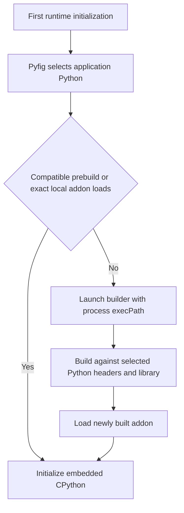

# Pynect

Pynect lets Node.js and Bun call Python modules in-process with generated TypeScript declarations and optional Python-side Pydantic validation. Python type hints remain the source of truth, so projects do not need a separately maintained controller interface or TypeScript validation schema.

Python remains responsible for normalization and validation. If Pydantic 1 or 2 is importable, annotated arguments and return values are validated automatically. Pydantic is optional; Pynect does not install it.

## Install

```sh
bun add --trust pynect
```

Declare application Python dependencies. Pynect's trusted postinstall aggregates reachable package manifests and asks Pyfig to prepare the content-addressed environment:

```json
{
  "pynect": {
    "project": {
      "requires-python": ">=3.11,<3.13",
      "dependencies": ["pydantic>=2,<3"]
    }
  }
}
```

The `pynect` value uses `project` for Python compatibility and dependencies, and
`tool.pynect` for environment policy and exposed modules. Omitted `schemaVersion`
means the latest schema supported by the installed Pynect release. The same shape
is accepted programmatically:

```ts
import { init } from 'pynect';

await init({
  project: {
    'requires-python': '>=3.11,<3.13',
    dependencies: ['pydantic>=2,<3'],
  },
});
```

When lifecycle scripts are disabled or Pynect is not trusted, run `bunx --bun pynect sync` explicitly.

Current Bun releases and Node.js 22 or newer are supported. Bun-only systems do not need a `node` executable. A preinstalled Python or uv is also unnecessary: Pynect uses Pyfig 0.7 to reuse a compatible application environment or create a content-addressed environment below `<project-root>/node_modules/.pyfig/venvs`, installing compatible uv and managed GIL-enabled Python releases when necessary. One CPython Stable ABI prebuild supports GIL-enabled Python 3.10 and newer on each packaged platform and architecture. Incompatible platform baselines fall back to compiling with the active JavaScript runtime from `process.execPath` and require a C++ toolchain.

## Quick start

Add a typed Python module such as `calculator.py`:

```python
def add(left: int, right: int) -> int:
    return left + right
```

Generate declarations for the project. With no module arguments, Pynect discovers Python files under conventional `src` or `python` source roots, falling back to the current directory. Public members are included by default; private modules, private members, and files ending in `_example.py` are skipped:

```sh
bunx --bun pynect codegen
```

`bunx --bun` makes Bun execute the package binary itself, so codegen does not require a separate Node.js installation.

Code generation uses [Pacwich](https://github.com/smorsic/pacwich) to resolve the current package or monorepo workspace. By default it also adds the generated declarations to `tsconfig.json`, adds a `codegen` package script when one does not exist, and ignores the generated metadata directory in `.gitignore`.

Use the generated module type directly:

```ts
import { importModule } from 'pynect';

const calculator = await importModule('calculator');
console.log(await calculator.add(2, 3));
```

`importModule()` initializes the shared runtime with defaults on first use and the runtime shuts down automatically when the process finishes. Call `init(config)` first only when custom runtime settings are needed. Call `shutdown()` explicitly only when the application needs to release Python before process exit.

## JavaScript callbacks

Python `Callable[...]` parameters generate as `PynectCallback` function types. Pass a synchronous or asynchronous JavaScript function directly; Pynect registers it for that Python call and releases it when the returned promise settles:

```python
from collections.abc import Callable

def transform(values: list[int], apply: Callable[[int], int]) -> list[int]:
    return [apply(value) for value in values]
```

```ts
import { importModule } from 'pynect';

const transforms = await importModule('transforms');
const result = await transforms.transform(
  [1, 2, 3],
  (value: number) => value * 2,
);
```

Callback implementations may return a value or a promise. They may also call Python again; while Python waits for JavaScript, the waiting worker releases the GIL and services queued Python work, so reentry remains live even with a one-thread pool. JavaScript errors become Python exceptions and return through the outer call as normal Pynect errors.

The callback is valid only for the Python call receiving it and becomes invalid when that call's promise settles. Python must not retain it for later use. `callIsolated()` cannot accept callbacks because functions and embedded Python objects do not cross its process boundary.

Nested callback depth defaults to the embedded interpreter's active `sys.getrecursionlimit()` value, normally 1000. Applications can choose a lower positive ceiling uniformly through API config, the root manifest, or the environment:

```ts
await init({ callbacks: { maxDepth: 100 } });
```

```json
{
  "pynect": {
    "tool": {
      "pynect": {
        "callbacks": { "maxDepth": 100 }
      }
    }
  }
}
```

The equivalent environment variable is `PYNECT_CALLBACK_MAX_DEPTH`.

## Add Pydantic validation

For Python-side normalization and validation, use Pydantic models in a module such as `users.py`:

```python
from pydantic import BaseModel

class UserInput(BaseModel):
    name: str
    age: int

class UserResult(BaseModel):
    id: int
    name: str

def create_user(data: UserInput) -> UserResult:
    return UserResult(id=1, name=data.name)
```

Regenerate the project declarations:

```sh
bunx --bun pynect codegen
```

Then restrict the dispatcher to fully typed members in that module:

```ts
import { init, importModule } from 'pynect';

await init({
  dispatcher: {
    include: ['users.*'],
    typedOnly: true,
  },
});

const users = await importModule('users');
const user = await users.create_user({ name: 'Alice', age: 30 });
console.log(user.name);
```

When Pydantic is installed in the selected Python environment, the input object becomes a `UserInput` before the function runs. The returned `UserResult` is validated and converted to JSON-compatible Python values before it crosses back to JavaScript. Without Pydantic, the annotated Python call still works but Pydantic validation is skipped.

## Why Pynect

Pynect and [PyBridge](https://github.com/marcj/pybridge) connect TypeScript and Python with different execution models. Pynect may be a better fit when you want:

- CPython embedded in the Node.js or Bun process instead of a Python subprocess connected over standard input and output.
- TypeScript declarations generated by inspecting Python modules instead of a separately maintained TypeScript controller interface.
- Direct proxy access to Python modules, classes, objects, and functions.
- Optional Pydantic 1 or 2 validation and normalization in Python, including Python-defined validators and serializers.
- Include, exclude, type-hint, and export policies enforced at the dispatcher boundary.
- Automatic embeddable-Python discovery with a checksum-verified uv fallback when Python is unavailable or lacks development headers.

PyBridge may be a better fit when every call must be process-isolated, or when RxJS generator streaming or Deepkit runtime serialization and reflection matter more than direct in-process access.

The main tradeoff is isolation versus integration. Normal Pynect proxy calls avoid subprocess transport and duplicate controller definitions, while its optional JSON-only worker provides hard termination for selected calls. CPython 3.10+ Stable ABI platform prebuilds avoid a local compiler; fallback builds still require a C++ toolchain.

## Python and native build

The package first loads a prebuilt N-API addon whose platform, architecture, Python Stable ABI floor, N-API version, and Linux glibc baseline match the active process. The addon targets CPython's 3.10 Limited API. On Linux and macOS, Pynect materializes it beside a generic `libpython3` symlink to the exact GIL-enabled library selected by Pyfig, so the binary does not depend on the CI machine's Python path or minor version. It then checks for an exact local build whose manifest names the selected interpreter. If neither addon works, Pynect lazily builds one against that interpreter. The builder is launched with `process.execPath`, so Bun launches Bun and Node.js launches Node.js instead of assuming a `node` command exists. The same approach works with another Node-compatible runtime when it implements the child-process and N-API behavior Pynect needs.



Pynect requires Python 3.10 or newer, `Python.h`, a linkable CPython library, and the standard GIL-enabled ABI. It rejects a runtime-only or free-threaded installation instead of compiling against unrelated `python3-config` output. When no compatible interpreter exists, Pyfig downloads the pinned uv archive from Astral's GitHub release, verifies its SHA-256 checksum, and installs managed Python 3.12.

Builds, the embedded runtime, codegen, isolated workers, and uv package operations all use the same Pyfig-selected interpreter. Pyfig reuses a compatible active or root `.venv` when no requirements are declared; applications with dependencies use a private content-addressed environment below `node_modules/.pyfig/venvs`.

## Application environment

One application owns one Pyfig-selected environment. Reusable npm packages contribute dependency constraints and exposed modules through their `package.json` without installing anything themselves:

```json
{
  "name": "@acme/name-generator",
  "dependencies": {
    "pynect": "^0.2.0"
  },
  "pynect": {
    "project": {
      "requires-python": ">=3.11,<3.13",
      "dependencies": ["name-generator>=1,<2"]
    },
    "tool": {
      "pynect": {
        "modules": {
          "generator": {
            "import": "name_generator",
            "include": ["generate_name"]
          }
        }
      }
    }
  }
}
```

`pynect sync` walks the installed npm dependency graph, aggregates `project.dependencies`, and passes them directly to Pyfig 0.7. Pyfig delegates resolution to uv and creates a content-addressed environment whose identity includes the selected interpreter, platform, ABI, and complete resolved dependency hashes. uv's shared cache avoids repeated downloads across environments. Pynect does not generate intermediary dependency metadata, a lockfile, a state file, or a second environment identity.

Pynect does not implement a Python package resolver. Conflicts and platform-specific selections are handled by Pyfig and uv, while Pynect adds the npm packages that contributed each top-level dependency to failure output. Dependency manifests may declare `project` dependency metadata and `tool.pynect.modules`; Python selection, requirements files, installation policy, indexes, and credentials remain application-owned.

Applications that need a checked-in, pinned resolution can provide a requirements file directly to Pyfig through the root manifest:

```json
{
  "pynect": {
    "tool": {
      "pynect": {
        "requirements": ["requirements.lock"]
      }
    }
  }
}
```

Relative requirements paths resolve from the application root. Configure private indexes with uv's application environment variables such as `UV_DEFAULT_INDEX`; keep credentials outside `package.json`.

Exposed module ids are namespaced by npm package name:

```ts
import { importModule } from 'pynect';

const generator = await importModule('@acme/name-generator:generator');
console.log(await generator.generate_name());
```

The aggregated `modules.include` patterns are enforced by the runtime dispatcher. When `include` is omitted, that manifest exposes the module's public callables; application dispatcher includes are additive, and excludes always win.

Runtime and `pynect sync` use the same Pyfig options. Production and CI can prepare explicitly, and can combine a pinned requirements file with offline mode when all artifacts are already cached:

```sh
bunx --bun pynect sync --offline
```

Pynect's postinstall runs the same sync automatically when a reachable npm package contributes a `pynect` manifest. Set `PYNECT_SKIP_POSTINSTALL=1` to opt out. npm users can also use `--ignore-scripts`; Bun users must explicitly trust `pynect` because Bun blocks dependency lifecycle scripts by default:

```json
{
  "trustedDependencies": ["pynect"]
}
```

An application may always keep installation side-effect free and run `pynect sync` explicitly instead.

Package and programmatic configuration use the same Pynect manifest shape. Configuration precedence is API or CLI, environment, root `package.json`, then default:

| package.json / API | Environment | CLI | Default |
| --- | --- | --- | --- |
| `tool.pynect.python` | `PYNECT_PYTHON` | `--python` | auto-detect |
| `project["requires-python"]` | `PYNECT_REQUIRES_PYTHON` | `--requires-python` | `>=3.10.0 <4.0.0` |
| `tool.pynect.managedPython` | `PYNECT_MANAGED_PYTHON` | `--managed-python` | `3.12` |
| `project.dependencies` | n/a | `--dependency` | `[]` |
| `tool.pynect.requirements` | n/a | `--requirement` | `[]` |
| `tool.pynect.requiresUv` | `PYNECT_REQUIRES_UV` | `--requires-uv` | `>=0.10,<1` |
| `tool.pynect.installPython` | `PYNECT_INSTALL_PYTHON` | `--install-python` | `true` |
| `tool.pynect.installUv` | `PYNECT_INSTALL_UV` | `--install-uv` | `true` |
| `tool.pynect.createVirtualEnvironment` | `PYNECT_CREATE_VIRTUAL_ENVIRONMENT` | `--create-virtual-environment` | `true` |

`--offline` sets uv's offline policy for the complete Pyfig preparation. There are no flat configuration aliases; package.json, programmatic configuration, and CLI overrides all map to the same `project` and `tool.pynect` structure.

Pynect uses [loqkit](https://www.npmjs.com/package/loqkit) for JavaScript critical sections. Native builds use its layered memory, worker-thread, and cross-process file locks. Runtime lifecycle and Python garbage collection use memory-scoped locks because those resources belong to one JavaScript process. Pyfig owns environment provisioning coordination. Pynect does not maintain separate promise, module, inspection, or proxy memo caches; new memoized getters should use loqkit's `memoize` primitive.

Pyfig's managed-tool provisioning uses its own check-lock-check sections:

1. Check for an existing tool.
2. Acquire a cross-process file lock.
3. Check again.
4. Install only if it is still absent.

A C++ build toolchain is required only when no compatible prebuild is available. On Windows, fallback builds need Visual Studio Build Tools with the Desktop development with C++ workload. Set `PYNECT_INSTALL_PYTHON=0` to prohibit managed Python downloads while still allowing environment creation from a compatible setup-python or system interpreter. Set `PYNECT_INSTALL_UV=0` to prohibit uv installation, `PYNECT_CREATE_VIRTUAL_ENVIRONMENT=0` to require an existing compatible environment, or `PYNECT_PYTHON` to check a specific interpreter first.

## Codegen selection

The simplest form discovers project modules and generates every public member:

```sh
bunx --bun pynect codegen
```

Pass module names when you only want specific modules:

```sh
bunx --bun pynect codegen users billing
```

Add repeatable include and exclude patterns when a project needs a narrower surface. Supplying `--include` restricts output to matching members. Supplying `--typed` restricts output to fully typed members. `--exclude` always excludes. Patterns match leaf or qualified names:

```sh
bunx --bun pynect codegen users billing \
  --include 'users.*' \
  --include 'billing.Invoice*' \
  --exclude '*internal*' \
  --typed
```

For reusable settings, put the same options in `pynect.config.json`:

```json
{
  "src": ["./python"],
  "outDir": "./generated",
  "include": ["users.*", "billing.Invoice*"],
  "exclude": ["*internal*"],
  "typed": true,
  "configure": true
}
```

The CLI uses Commander. Configuration precedence is CLI, environment, JSON config, then defaults. Set `"configure": false` or pass `--no-configure` to prevent edits to `tsconfig.json`, `package.json`, and `.gitignore`. Use `--tsconfig` when the workspace uses a nonstandard config filename.

Automatic discovery skips directories, packages, and modules whose names begin with `_`, common environment and build directories, and files ending in `_example.py`. The same private-package rule applies to explicitly requested module paths. Use repeatable `--src` options when Python lives somewhere else:

```sh
bunx --bun pynect codegen --src ./backend --src ./shared-python
```

Local source files are parsed with Python's AST and are not imported during generation. Explicit installed modules that cannot be resolved under a configured source root use live inspection so packages such as NumPy and pandas can still expose their runtime API.

Use centralized overrides for opaque extension types or legacy untyped functions:

```json
{
  "typeOverrides": {
    "UUID": "string",
    "Decimal": "number"
  },
  "signatureOverrides": {
    "legacy.lookup": "(userId: string): Promise<User>",
    "legacy.Client.fetch": "(limit?: number): Promise<User[]>"
  }
}
```

Type overrides map a Python annotation name wherever it appears. Signature overrides are keyed by the fully qualified function or method name and replace its generated TypeScript call signature.

Other commands:

```sh
bunx pynect codegen --list
bunx pynect codegen --all
bunx pynect codegen --clear
```

`--all` means all modules tracked in generated metadata. Within each requested module, the default is all public members. Use `--exported` to require the `@export` marker or `--typed` to require complete parameter and return type hints.

## Raw module imports

Generated declarations are the normal application workflow. For exploration, third-party packages, or Python modules that do not need generated types, import a module directly:

```ts
import { importModule } from 'pynect';

const math = await importModule('math');
console.log(await math.sqrt(9));
```

Raw imports return a dynamic Python proxy. Run codegen when the module should provide TypeScript inference in application code.

## Runtime policy

```ts
await init({
  autoShutdown: true,
  dispatcher: {
    include: ['my_app.*'],
    exclude: ['*.admin.*', '*._*'],
    typedOnly: true,
    exportedOnly: false,
    validation: 'auto', // auto, required, or off
  },
  allowUnsafeCode: false,
  includeTracebacks: false,
});
```

`autoShutdown` defaults to `true` for both the embedded runtime and the optional isolated worker. Set it to `false` only when the host owns lifecycle and will call `shutdown()` explicitly.

Defaults are intentionally conservative around dangerous bridge features:

- Raw `eval`, `exec`, file execution, contexts, and native-addon access are disabled.
- Python dependencies are declared before initialization and resolved by Pyfig.
- Python tracebacks are hidden.
- Private callables and modules are rejected.
- Excludes override includes and decorators.
- Pydantic validation is automatic only when Pydantic is already importable.

Every normal proxy function, method, and constructor call passes through this policy and validation dispatcher.
`typedOnly` and `exportedOnly` are independent: enabling both requires every callable to be explicitly exported and fully typed.

The worker pool defaults to the larger of four workers or the host's available CPU count. This improves queue scheduling; the CPython GIL still prevents CPU-bound Python bytecode from running in parallel within one interpreter.

## Cancellation and timeouts

`callTimeout` limits time waiting in the native queue. `executionTimeout` separately cancels asynchronous Python execution:

```ts
await init({
  callTimeout: 2_000,
  executionTimeout: 10_000,
});
```

Every generated function and method includes a typed `withOptions()` call:

```ts
import { importModule } from 'pynect';

const jobs = await importModule('jobs');
const controller = new AbortController();

setTimeout(() => controller.abort(), 1_000);
await jobs.run_job.withOptions(
  { signal: controller.signal, executionTimeout: 5_000 },
  { id: 42 },
);
```

`withOptions` is a property on the callable, so it does not consume a sibling module name such as `run_jobWithOptions`. If a Python callable itself defines a `withOptions` attribute, use the exported `PYNECT_WITH_OPTIONS` symbol for the bridge operation:

```ts
import { PYNECT_WITH_OPTIONS } from 'pynect';

await jobs.run_job[PYNECT_WITH_OPTIONS](
  { executionTimeout: 5_000 },
  { id: 42 },
);
```

Queued calls are removed before execution when possible. Running async functions are cancelled on the persistent asyncio loop. Arbitrary synchronous CPython code cannot be interrupted safely inside the Node.js process.

## Isolated calls

Enable the optional worker when a call needs a hard timeout or when an ordinary Python interpreter crash should be contained outside the Node.js process:

```ts
import { callIsolated, init, shutdown } from 'pynect';

await init({
  isolation: {
    enabled: true,
    timeout: 30_000,
  },
  dispatcher: {
    include: ['jobs.*'],
  },
});

try {
  const result = await callIsolated(
    'jobs',
    'run_job',
    [{ id: 42 }],
    { timeout: 5_000 },
  );
  console.log(result);
} finally {
  await shutdown();
}
```

Isolated calls use a lazy persistent Python child process and JSON-compatible arguments and results. Calls through that worker are serialized. A timeout or abort terminates it, rejects its outstanding calls, and lets the next call start a fresh worker. The child process still has the operating-system permissions of the current user; use an OS sandbox or container for hostile code.

## Pydantic modes

- `auto`: validate every supported argument and return annotation when Pydantic 1 or 2 is available; otherwise preserve Python behavior. This is the default for all normal callable dispatches.
- `required`: reject calls when Pydantic is missing or cannot build a validator for an annotation.
- `off`: never ask Pydantic to validate.

Pydantic models, aliases, defaults, nested models, enums, dates, UUIDs, and standard annotated containers use Pydantic's own validation and serialization behavior. Custom validators and serializers run in Python; Pynect does not attempt to reproduce them in TypeScript.

Pydantic cannot infer a validation target for an unannotated value, and some extension callables do not expose an inspectable signature. Those calls still pass through the dispatcher and its access policy, but their untyped values retain normal Python behavior.

## Current limits

- Normal proxy calls are in-process. A native Python crash can terminate Node or Bun; use `callIsolated()` where a process boundary is required.
- In-process execution timeouts and aborts are cooperative for async functions. Hard termination of synchronous code requires `callIsolated()`.
- Async Python uses one persistent asyncio loop. CPU-bound work still needs Python multiprocessing or native extensions that release the GIL.
- Local modules use safe AST inspection, but codegen for explicitly requested installed packages imports those packages and may run their import-time code.
- The isolated worker is not an operating-system sandbox and supports only JSON-compatible calls, not Python object proxies.
- JavaScript callbacks are in-process and scoped to the Python call promise; Python code cannot retain them after that promise settles.
- The npm package includes CPython 3.10+ Stable ABI prebuilds for Linux, macOS, and Windows on x64 and ARM64. Incompatible platform baselines require a local C++ toolchain for the fallback build; free-threaded Python remains unsupported.

See [SECURITY.md](./SECURITY.md) before exposing imports or call patterns to untrusted input.

## Development

```sh
bun install --frozen-lockfile
bun run verify
```

`verify` type-checks, rebuilds the addon, and runs the shared-interpreter smoke test. `scripts/docker-zero-python.sh` is the clean-container reproduction: it starts from the official Bun image, asserts that Node.js, Python, and uv are absent, installs the registry-published Pyfig dependency plus only the C++ toolchain, then verifies Pyfig bootstrap, lazy native compilation through Bun, and the full Pynect native boundary. The separate `Native binaries` workflow runs for native build or loader changes and can also be started manually.

### Publishing

Run `bun run release` from a clean, synchronized `main` branch. The command performs the full local release gate, commits the next patch version by default, creates a lightweight tag, and atomically pushes the branch and tag. Use `bun run release -- --dry-run`, `minor`, or `major` when needed.

The tag workflow publishes through npm Trusted Publishing with provenance. It fingerprints only native build inputs, including the C++ sources, build configuration, Python and N-API targets, and resolved native build dependencies. When the previous npm release has the same fingerprint, its integrity-verified six-platform prebuild set is reused. A changed or missing fingerprint runs the complete native matrix before the archive can be published.

## Project history

Pynect builds on [NodePyX](https://github.com/Brah-Timo/nodepyx) and retains its Git history and contributor attribution. Its public API, dispatcher policy, optional Pydantic integration, Python provisioning, codegen, and Windows build path have been revised for this project.

MIT licensed.
