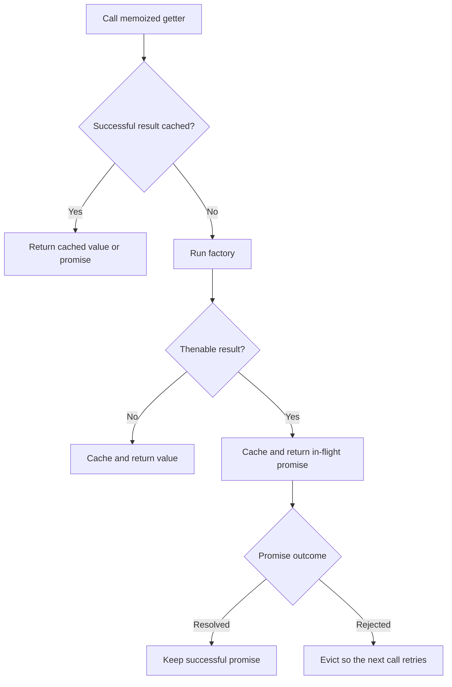
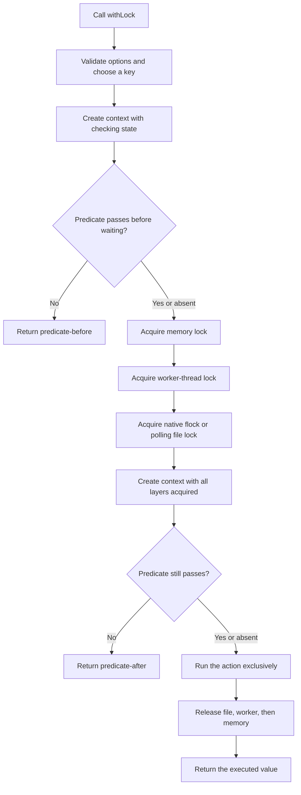
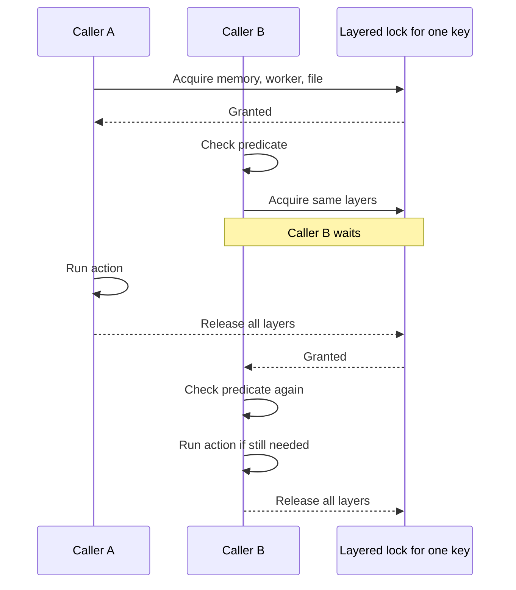

# loqkit

Typed memoization and layered locking for JavaScript runtimes.

## Locking

```ts
import { withLock } from "loqkit";

await withLock(
  { resource: "cache" },
  async ({ resource, lock }) => {
    console.log(`locked ${resource} with ${lock.backends.length} layers`);
  },
  async ({ resource }) => resource === "cache",
  { key: "cache-refresh" },
);
```

By default, `withLock` acquires memory, worker-thread, and file locks for the same key. The optional predicate runs once before waiting and again after all three layers are held. The action runs only when both checks pass.

Use a narrower scope only when you deliberately need one boundary:

```ts
await withLock(context, action, { scope: "memory" });
await withLock(context, action, { scope: "worker" });
await withLock(context, action, { scope: "file" });
```

## Memoization

`memoize` turns a zero-argument factory into a getter that computes once and reuses its successful result. A synchronous factory stays synchronous. An asynchronous or thenable factory returns a native promise, and concurrent callers share the same in-flight work.

```ts
import { memoize } from "loqkit";

const getConfig = memoize(() => ({ region: "us-east-1" }));
const config = getConfig();

const getCatalog = memoize(async () => {
  const response = await fetch("https://example.com/catalog.json");
  return response.json();
});

const catalog = await getCatalog();
```

Successful results remain cached for the lifetime of the memoized getter. Thrown errors and rejected promises are not cached, so the next call retries. There is no TTL or expiration behavior.



## How locking works

`withLock` is a key-scoped lock. Calls with the same namespace and key run one at a time; calls with different keys can run concurrently. If no key is supplied, loqkit hashes the context into a stable key.

The default `scope: "all"` acquires these layers in order and releases them in reverse:

1. An in-memory [`async-mutex`](https://github.com/DirtyHairy/async-mutex) lock serializes callers in the current JavaScript isolate.
2. Node's worker lock manager coordinates worker threads when the runtime provides it. In the default layered mode, the file layer still preserves coordination when that API is unavailable; an explicit worker-only lock reports `LockUnavailableError` instead.
3. A file lock coordinates processes on the same host. On macOS and Linux, `fileStrategy: "auto"` prefers the optional native [`fs-ext`](https://github.com/baudehlo/node-fs-ext) `flock` implementation. If native locking is unavailable or acquisition fails—for example, because a network filesystem does not support `flock`—loqkit transparently falls back to [`proper-lockfile`](https://github.com/moxystudio/node-proper-lockfile) polling.

Set `fileStrategy: "flock"` to explicitly prefer native `flock` with the same safe fallback, or `fileStrategy: "poll"` to skip native locking and use the portable polling implementation directly. A contention response stays on `flock`; switching protocols while another caller holds a native lock would break exclusivity. Filesystems that incorrectly report a successful native lock cannot be detected, so configure `"poll"` for a network mount known to have unreliable `flock` semantics. `lockDirectory` or `LOQKIT_LOCK_DIR` controls where file locks are stored.



The second predicate check matters when another caller changes the underlying state while this caller is waiting:



The default file directory is local to the host. Containers coordinate only when they share the configured lock directory, and separate hosts still need a shared lock service or database-backed lock.
