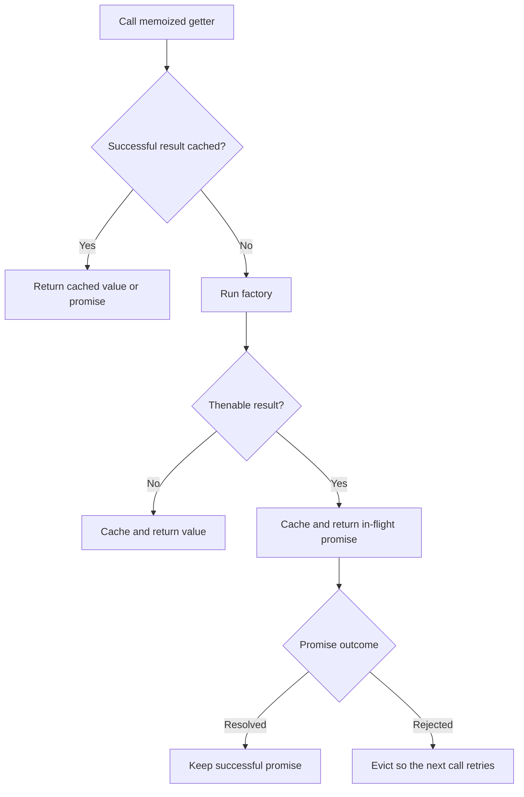
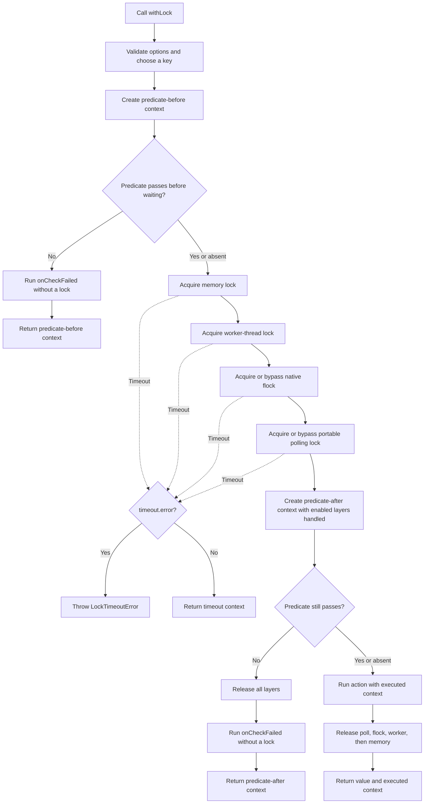
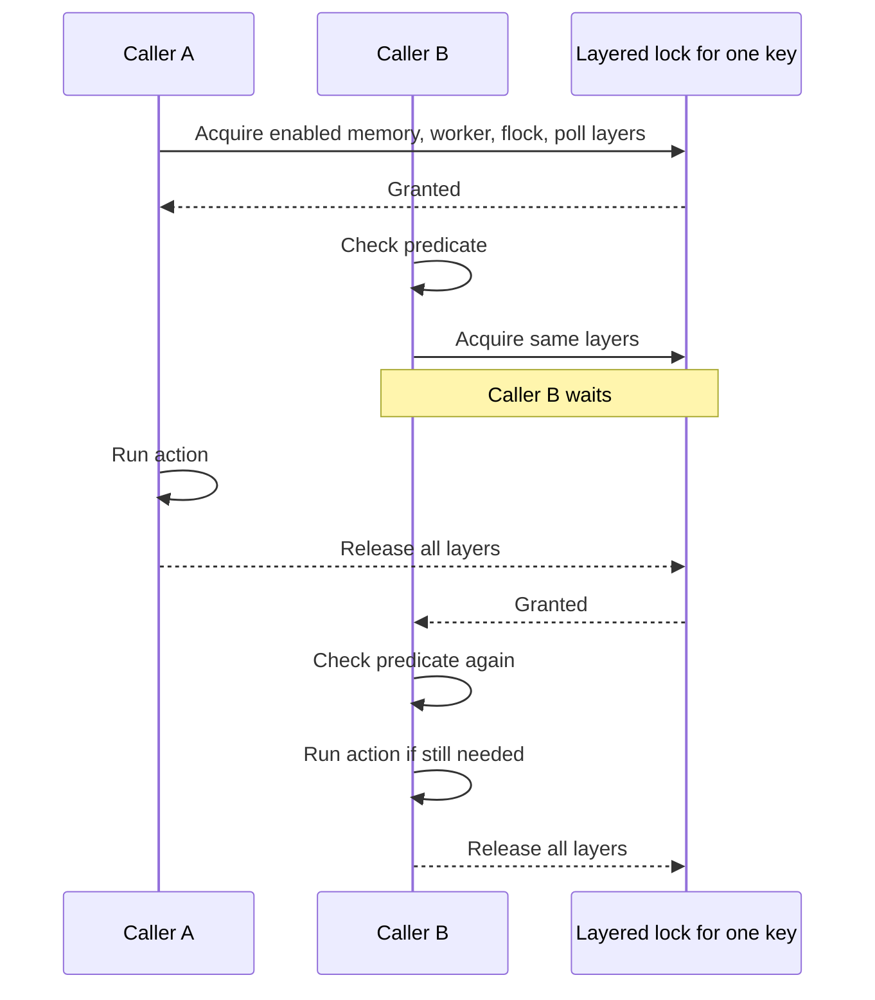

# loqkit

Typed memoization and layered locking for JavaScript runtimes.

Loqkit publishes matching ESM and CommonJS entry points.

## Locking

```ts
import { withLock } from "loqkit";

const result = await withLock(
  { resource: "cache" },
  async ({ resource, lock }) => {
    console.log(`locked ${resource} with ${lock.backends.length} layers`);
  },
  {
    key: "cache-refresh",
    predicate: async ({ resource, state }) => {
      return state === "predicate-after"
        ? await stillNeedsRefresh(resource)
        : true;
    },
    onCheckFailed: async ({ resource, state }) => {
      console.log(`${resource} skipped in ${state}`);
    },
  },
);

console.log(result.value, result.context.state, result.context.lock.waitedMs);
```

By default, `withLock` requires an in-memory lock, uses worker-thread and native `flock` locks when available, and uses portable polling when native flock is skipped. The argument after the action can be a predicate function or an options object containing `predicate`. The predicate runs once before waiting and again after every enabled layer has been handled. The action runs only when both checks pass.

Every callback receives `ctx.state`: `"predicate-before"` for the first check, `"predicate-after"` for the check after acquisition, and `"executed"` for the action. When either check fails, `onCheckFailed(ctx)` runs after any acquired layers have been released. It can inspect `ctx.state`, log, reread data, or start other lock work without holding this lock.

`withLock` returns `{ value, context }`. `value` is the action's result, or `undefined` when the action did not run. The returned context has the same fields and state values as a callback context, with `"timeout"` added because a non-throwing timeout can only be observed in the result. Lock metadata, including wait time, is available on `result.context.lock`.

Omitting `timeout` waits indefinitely. A numeric timeout throws `LockTimeoutError` when it expires. Use the object form to return a timeout result instead. A zero timeout makes one non-blocking acquisition attempt and never sleeps or polls a second time:

```ts
const attempt = await withLock(context, action, {
  timeout: { ms: 0, error: false },
});

if (attempt.context.state === "timeout") {
  console.log("Lock is busy");
}
```

`scope` is a partial configuration map. Omitting the map or a property uses its default; `false` disables that layer. Worker and flock additionally accept `"auto"`, which uses the layer when available and otherwise records it as skipped:

```ts
await withLock(context, action, {
  scope: { worker: false, flock: false },
});

await withLock(context, action, {
  scope: { memory: false, worker: true, flock: false, poll: false },
});
```

| Scope | Values | Default | Behavior |
| --- | --- | --- | --- |
| `memory` | `true`, `false` | `true` | Locks within the current JavaScript isolate. |
| `worker` | `true`, `false`, `"auto"` | `"auto"` | Coordinates worker threads. `true` throws `LockUnavailableError` when the runtime API is unavailable. |
| `flock` | `true`, `false`, `"auto"` | `"auto"` | Uses native advisory file locking. `true` throws `LockUnavailableError` when native support is unavailable or fails. |
| `poll` | `true`, `false`, `"auto"` | `"auto"` | Uses the portable polling file lock. `"auto"` skips it when native flock was acquired and otherwise requires it. |

Enabled layers always run in `memory`, `worker`, `flock`, `poll` order and release in reverse. Setting all four to `false` is allowed and runs the predicate and action without an exclusivity boundary.

Callbacks and results expose the resolved outcome on `ctx.lock.scope`. It contains a boolean for `memory`, and `true`, `false`, or `"skipped"` for `worker`, `flock`, and `poll`; `"auto"` never appears there. An automatic layer can change from `true` in the first predicate context to `"skipped"` after acquisition determines that it is unsupported or redundant. `ctx.lock.backends` retains the lower-level implementation and fallback details.

## Memoization

`memoize` turns a zero-argument factory into a getter that computes once and reuses its successful result. A synchronous factory stays synchronous. An asynchronous or thenable factory returns a native promise, and concurrent callers share the same in-flight work.

```ts
import { memoize } from "loqkit";

const getConfig = memoize(() => ({ region: "us-east-1" }));
const config = getConfig();

const getCatalog = memoize(async () => {
  const response = await fetch("https://example.com/catalog.json");
  return response.json();
});

const catalog = await getCatalog();
```

Successful results remain cached for the lifetime of the memoized getter. Thrown errors and rejected promises are not cached, so the next call retries. There is no TTL or expiration behavior.



## How locking works

`withLock` is a key-scoped lock. Calls with the same namespace and key run one at a time; calls with different keys can run concurrently. If no key is supplied, loqkit hashes the context into a stable key.

When `scope` is omitted, loqkit handles these layers in order and releases acquired layers in reverse:

1. An in-memory [`async-mutex`](https://github.com/DirtyHairy/async-mutex) lock serializes callers in the current JavaScript isolate.
2. Node's worker lock manager coordinates worker threads when the runtime provides it. The default `"auto"` mode records this layer as skipped when that API is unavailable.
3. On macOS and Linux, the optional [`fs-ext`](https://github.com/baudehlo/node-fs-ext) layer uses native `flock`. The default `"auto"` mode records the layer as skipped when native locking is unavailable or acquisition fails, including filesystems that reject `flock`.
4. A [`proper-lockfile`](https://github.com/moxystudio/node-proper-lockfile) polling lock coordinates processes that share the configured lock directory. Its default `"auto"` mode acquires it when flock was skipped or disabled and skips it after flock succeeds.

An automatic flock layer is bypassed only for unavailability or a non-contention acquisition failure. Ordinary contention continues waiting on flock so exclusivity is preserved. Set `scope.poll` to `true` to require both mechanisms; because flock has already serialized loqkit callers, polling contention in that state fails immediately with `LockUnavailableError` instead of waiting forever. Set `scope.flock` to `false` for a network mount known to have unreliable flock semantics. `lockDirectory` or `LOQKIT_LOCK_DIR` controls where both file-based layers store their lock files.



The second predicate check matters when another caller changes the underlying state while this caller is waiting:



The default file directory is local to the host. Containers coordinate only when they share the configured lock directory, and separate hosts still need a shared lock service or database-backed lock.

## Releasing

Run `bun run release` from a clean, synchronized `main` branch. Patch is the default increment; `minor`, `major`, and `--dry-run` are also supported. The existing untagged npm `0.0.1` requires the one-time bootstrap form `bun run release -- --initial`.

The local command verifies the Git identity, derives the next version from remote GitHub tags, runs the full suite, and audits the package archive before atomically pushing the release commit and tag. [The tag workflow](.github/workflows/publish.yml) repeats verification because release tags are not protected, then publishes the exact audited archive through npm Trusted Publishing with provenance. It does not use an npm token.
