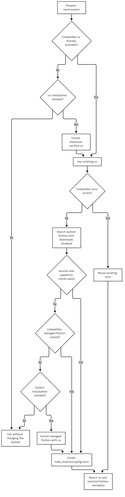
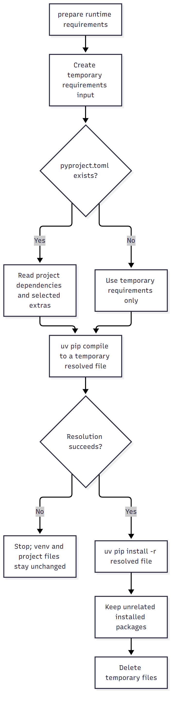

# pyfig

`pyfig` prepares uv and a compatible Python virtual environment from Bun or Node.js. It prefers a valid uv already on the system, reuses a compatible venv, and searches system Python with downloads disabled before considering any managed Python download.

Pyfig never invokes standalone `pip`, never writes `pyproject.toml` or requirements files, and never creates a project-root `.venv`. When no compatible venv exists, its private environment is `<project-root>/node_modules/.pyfig/venv`.

## Install

```sh
bun add pyfig
```

## Use

```ts
import { createPyfig } from 'pyfig';

const pyfig = createPyfig({
  pythonRange: '>=3.11.0 <4.0.0',
  requireEmbedding: true,
  requireGil: true,
});

const environment = await pyfig.prepare(
  ['requests>=2.32'],
  { extras: ['database'] },
);

console.log(environment.uv);
console.log(environment.python);
console.log(environment.managed);

await pyfig.uv(
  ['run', '--', 'python', 'script.py'],
  { stdio: 'inherit' },
);
```

`prepare()` accepts runtime requirement strings plus optional `extras`, `groups`, or `allExtras`. If the project has a `pyproject.toml`, uv resolves that read-only input together with a temporary requirements file. Pyfig installs the resolved result with `uv pip install -r`, which preserves unrelated packages. Temporary inputs are created outside the repository and removed afterward.

The same uv-only surface handles direct commands:

```ts
import { uvSpawn, uvSpawnSync } from 'pyfig';

await uvSpawn(['pip', 'list'], { stdio: 'inherit' });

const result = uvSpawnSync(
  ['run', '--', 'python', '-c', 'import sys; print(sys.executable)'],
  { encoding: 'utf8' },
);
```

For `uv pip` and `uv run`, Pyfig selects the venv and injects its exact interpreter. Caller-supplied target overrides such as `--python`, `--system`, `--target`, `--prefix`, and `--user` are rejected. Inherited target-changing environment variables are removed. Other uv commands run with Pyfig's cache and system-Python preference but are otherwise unchanged.

The async spawn helper returns `Promise<ChildProcess>` because uv or environment setup may happen before spawning. The synchronous helper performs setup through `process.execPath`, so a Bun process remains Bun and does not assume a `node` command exists.

## Selection policy

Pyfig uses this order:

1. A compatible configured or `PATH` uv.
2. Pyfig's cached, checksum-verified uv.
3. A compatible explicitly configured venv, active `VIRTUAL_ENV`, root `.venv`, or Pyfig-owned venv.
4. Every installed system Python reported by uv, with downloads disabled, until one passes all capability checks.
5. An already-cached uv-managed Python that passes the same checks.
6. A managed Python download, only when installation policy allows it.

An explicit `python` option is strict: an unavailable or incompatible interpreter is an error. Incompatible external venvs are preserved and skipped. Only an incompatible environment under `node_modules/.pyfig/venv` may be rebuilt.



[Mermaid source](docs/diagrams/python-selection.mmd)

Native consumers can set `requireEmbedding: true` to require CPython, `Python.h`, a linkable embedding library, and architecture/pointer-width compatibility with the JavaScript runtime. Set `requireGil: true` when the native addon requires the standard GIL-enabled ABI. These checks apply to system, existing-venv, cached, and downloaded interpreters alike.

## Runtime dependency resolution

```ts
await pyfig.prepare(
  ['orjson>=3.10', 'httpx[http2]'],
  {
    extras: ['postgres'],
    groups: ['runtime'],
  },
);
```

Resolution follows the equivalent of:

```sh
uv pip compile pyproject.toml /temporary/runtime-requirements.txt \
  --extra postgres --group runtime \
  --python /selected/venv/python \
  --output-file /temporary/resolved-requirements.txt

uv pip install \
  --python /selected/venv/python \
  -r /temporary/resolved-requirements.txt
```

When no `pyproject.toml` exists, only the temporary requirements input is compiled. Extras and dependency groups require an existing `pyproject.toml`. Pyfig does not use `uv add` or `uv pip sync`: the former would edit project metadata, while the latter could remove unrelated packages from the venv.



[Mermaid source](docs/diagrams/runtime-dependencies.mmd)

## Project root

Pyfig does not interpret `package.json`, workspace metadata, `pyproject.toml`, or lockfiles to choose ownership. Root precedence is:

1. `projectRoot`
2. `PYFIG_PROJECT_ROOT`
3. nearest Git worktree marker above `INIT_CWD`, when set, otherwise the current directory
4. that starting directory when no Git marker exists

Set `projectRoot` explicitly in reusable libraries and unusual workspace layouts.

## Public API

| Export | Responsibility |
| --- | --- |
| `createPyfig(options)` | Create a scoped client with memoized base preparation. |
| `client.prepare(requirements?, options?)` | Select a venv and optionally resolve/install runtime dependencies. |
| `client.pythonInfo()` | Return the selected interpreter and embedding metadata. |
| `client.uvInfo()` | Return the selected uv executable and version. |
| `client.uv()` / `client.uvSync()` | Spawn uv and pin pip/run commands to the selected venv. |
| `ensureEnvironment(options?, requirements?, dependencyOptions?)` | Standalone preparation API. |
| `ensureUv(options?)` | Prefer existing uv, otherwise bootstrap verified uv when allowed. |
| `uvSpawn()` / `uvSpawnSync()` | Standalone uv spawn API. |
| `resolveProjectRoot(start?)` | Resolve the nearest Git root without reading manifests. |

The package exposes matching ESM and CommonJS entry points. Probe, download, lock, and command-policy internals are not exported.

## Configuration

Precedence is API or CLI option, environment variable, then default.

| API option | Environment variable | Default |
| --- | --- | --- |
| `python` | `PYFIG_PYTHON` | uv discovery |
| `pythonRange` | `PYFIG_PYTHON_RANGE` | `>=3.10.0 <4.0.0` |
| `managedPython` | `PYFIG_MANAGED_PYTHON` | `3.12` |
| `uvVersion` | `PYFIG_UV_VERSION` | `0.13.6` |
| `uvRange` | `PYFIG_UV_RANGE` | `>=0.10.0 <1.0.0` |
| `cacheDir` | `PYFIG_HOME` | OS cache directory |
| `projectRoot` | `PYFIG_PROJECT_ROOT` | `INIT_CWD`, Git root, or current directory |
| `requireEmbedding` | `PYFIG_REQUIRE_EMBEDDING` | `false` |
| `requireGil` | `PYFIG_REQUIRE_GIL` | `false` |
| `autoInstall` | `PYFIG_AUTO_INSTALL` | `true` |
| `installPython` | `PYFIG_INSTALL_PYTHON` | `autoInstall` |
| `installUv` | `PYFIG_INSTALL_UV` | `autoInstall` |
| `createVirtualEnvironment` | `PYFIG_CREATE_VIRTUAL_ENVIRONMENT` | `autoInstall` |
| `probeTimeoutMs` | `PYFIG_PROBE_TIMEOUT_MS` | `10000` |
| `installTimeoutMs` | `PYFIG_INSTALL_TIMEOUT_MS` | `600000` |
| `downloadTimeoutMs` | `PYFIG_DOWNLOAD_TIMEOUT_MS` | `300000` |
| `coordinationTimeoutMs` | `PYFIG_COORDINATION_TIMEOUT_MS` | install + download + 60 seconds |

Set `PYFIG_UV` to choose an explicit uv executable. Set `PYFIG_AUTO_INSTALL=0` or use the CLI's `--check` flag on hosts where downloads and environment creation are prohibited.

## CLI

```sh
bunx --bun pyfig
bunx --bun pyfig --check
bunx --bun pyfig --python-range '>=3.12.0 <3.14.0'
bunx --bun pyfig --require-embedding --require-gil
bunx --bun pyfig --project-root /path/to/repository
bunx --bun pyfig --json
```

`bunx --bun` runs the CLI with Bun and does not require a separate Node.js executable.

## Concurrency and installation safety

Pyfig downloads an exact uv release archive over HTTPS, verifies its adjacent SHA-256 checksum, validates the staged executable version, and atomically publishes it in Pyfig's cache. It does not execute installer scripts or modify shell profiles.

Provisioning mutations use Loqkit's layered in-memory, worker, native-file-lock-when-available, and portable-file coordination with capability checks before and after acquisition. uv supplies its own target-environment lock for installs. Base client preparation is memoized; dependency preparation is intentionally rerun so uv can cheaply verify current inputs through its shared cache.

## Platform support

Pyfig bootstraps uv on x64 and arm64 Windows, macOS, and Linux. Linux uses Astral's static musl artifact, which also runs on glibc. Node.js 22 through 26 and Bun 1.2+ are supported. Other JavaScript runtimes may work when they provide compatible Node built-ins and process semantics.

## Publishing

Pyfig publishes from a `v<package-version>` Git tag through `.github/workflows/publish.yml`. The trusted-publishing workflow validates the tag, rejects an existing registry version, builds and audits one archive, and publishes that archive with provenance.

From a clean, synchronized `main` branch:

```sh
bun run release
```

The local gate derives the next version from remote GitHub tags, verifies locally, audits the package, commits, tags, and atomically pushes. Use `bun run release -- minor`, `bun run release -- major`, or `bun run release -- --dry-run` as needed. Tag publishing intentionally does not repeat the local test suite.

## Development

```sh
bun install --ignore-scripts
bun run verify
bun run build
bun pm pack --dry-run
```

MIT licensed.
