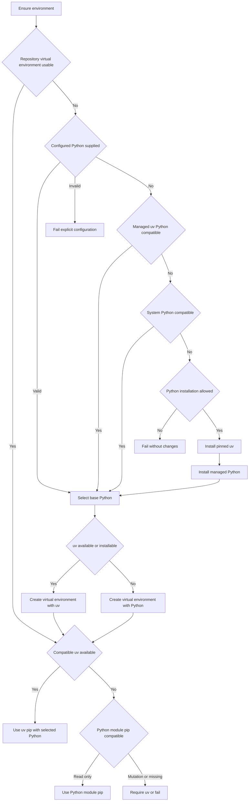
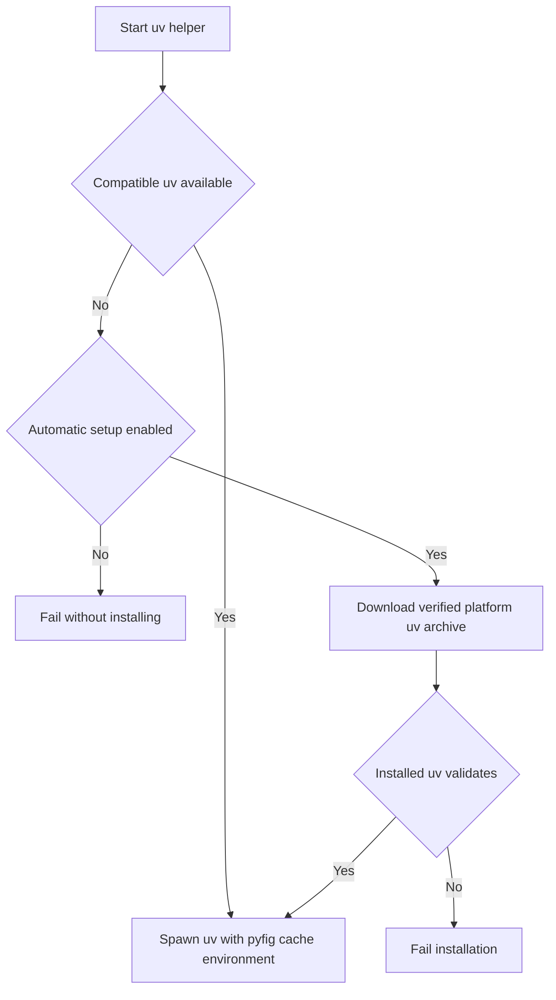

# pyfig

`pyfig` creates or reuses `<project-root>/.venv` and binds every Python and package subprocess to that environment from Bun or Node.js. A valid existing venv is the first choice. Otherwise Pyfig discovers a compatible interpreter, installs its checksum-verified uv and managed Python when necessary, and provisions the root venv without requiring Python or Node to be preinstalled alongside Bun.

## Install

```sh
bun add pyfig
```

## Library

```ts
import { createPyfig } from 'pyfig';

const pyfig = createPyfig({
  pythonRange: '>=3.11.0 <4.0.0',
  pipRange: '>=23.0.0',
  requireEmbedding: true, // require compatible CPython headers, library, and architecture
  requireGil: true,       // reject free-threaded CPython ABIs
});
const environment = await pyfig.prepare();

console.log(environment.python);
console.log(environment.packageManager);
```

Run Python, pip, and uv with standard argument arrays and child-process spawn options:

```ts
import {
  pipSpawn,
  pipSpawnSync,
  pythonSpawn,
  pythonSpawnSync,
  uvSpawn,
  uvSpawnSync,
} from 'pyfig';

const python = await pythonSpawn(['script.py', '--verbose'], { stdio: 'inherit' });
const pythonVersion = pythonSpawnSync(['--version'], { encoding: 'utf8' });

const pip = await pipSpawn(['install', 'ruff'], { stdio: 'inherit' });
const installed = pipSpawnSync(['list', '--format', 'json'], { encoding: 'utf8' });

const uv = await uvSpawn(['python', 'list'], { stdio: 'inherit' });
const uvVersion = uvSpawnSync(['--version'], { encoding: 'utf8' });
```

The asynchronous helpers return `Promise<ChildProcess>` because discovery or installation may precede the spawn. Synchronous helpers perform the same setup in a child launched with `process.execPath`, so Bun stays Bun and Node stays Node; no `node` executable is assumed. Python execution only requires the venv, not pip or uv. Package helpers additionally resolve uv and receive `VIRTUAL_ENV`, the venv scripts directory at the front of `PATH`, and the exact venv interpreter.

Pass any `PyfigOptions` as the third argument when a helper needs a custom Python range, pip range, project root, cache directory, or installation policy.

Pyfig publishes matching ESM and CommonJS entry points. The root API intentionally contains only configuration constants, the scoped client, preparation helpers, spawn helpers, project-root discovery, and public result types. Probe and lock internals are not package exports.

Defaults are Python `>=3.10.0 <4.0.0`, pip `>=20.3.0`, managed Python `3.12`, pinned uv `0.13.6`, and external uv `>=0.10.0 <1.0.0`. A compatible configured or PATH uv is preferred even when Pyfig's cached managed version is newer.

Package mutation is always performed by uv, whose own target-environment lock protects concurrent installs and removals. When uv installation is explicitly disabled, the venv interpreter's `python -m pip` remains available for read-only commands such as `list`; mutable pip commands are rejected. Standalone `pip` and `pip3` executables are never discovered or executed.

Native consumers can set `requireEmbedding: true` to require CPython, `Python.h`, a linkable library, and architecture/pointer-width compatibility with the JavaScript runtime. Probe results include implementation, architecture, pointer width, release level, base executable, and library kind. Set `requireGil: true` when an addon targets the standard GIL-enabled ABI.

Given the same `PyfigOptions`, `pipSpawn(['install', 'xyz'])` and `uvSpawn(['pip', 'install', 'xyz'])` resolve the same project root, `.venv`, and interpreter. Target-changing arguments such as `--python`/`-p`, `--system`, `--target`/`-t`, `--prefix`, and `--user` are rejected. Target-changing environment variables are removed, persistent package-manager configuration is disabled for these commands, and uv receives the exact venv interpreter through `UV_PYTHON`.

Project-root discovery uses Pacwich for workspace repositories. Single-package projects recognize Bun, npm, pnpm, Yarn, uv, and `pyproject.toml` metadata before falling back to a Git root, the nearest package manifest, or the current directory. Set `projectRoot` or `PYFIG_PROJECT_ROOT` to make ownership explicit.

## Decision flows

### Python, venv, and package manager



### Direct uv spawning



## CLI

```sh
bunx --bun pyfig
bunx --bun pyfig --check
bunx --bun pyfig --python-range '>=3.12.0 <3.14.0' --pip-range '>=24.0.0'
bunx --bun pyfig --require-embedding --require-gil
bunx --bun pyfig --project-root /path/to/repository
bunx --bun pyfig --json
```

`bunx --bun` runs the CLI with Bun itself and does not require a separate Node.js executable.

`--check` prohibits virtual-environment creation and tool installation, and exits nonzero when no compatible environment exists.

## Public API

| Export | Responsibility |
| --- | --- |
| `createPyfig(options)` | Bind one immutable policy object to preparation and spawn operations. |
| `ensureEnvironment()` | Return the root venv Python and its safe package manager. |
| `ensureVirtualEnvironment()` | Return the root venv Python without requiring package tooling. |
| `ensureUv()` | Return a compatible system uv or the verified managed uv. |
| `pythonSpawn[Sync]()` | Run the root venv interpreter. |
| `pipSpawn[Sync]()` | Run package commands against the root venv; mutations require uv. |
| `uvSpawn[Sync]()` | Run uv; direct `uv pip` calls receive the same strict target policy. |
| `resolveProjectRoot()` | Resolve workspace, package-manager, Python, or Git ownership. |

The standalone functions remain convenient for scripts and resolve current filesystem state on every call. Long-lived consumers such as Pynect should prefer `createPyfig()`: Loqkit memoizes each client's first successful preparation, Python, and uv resolution. Create a new client after intentionally changing its external toolchain.

## Configuration

Precedence is API/CLI option, environment variable, then default.

| API option | Environment variable | Default |
| --- | --- | --- |
| `python` | `PYFIG_PYTHON` | auto-detect |
| `pythonRange` | `PYFIG_PYTHON_RANGE` | `>=3.10.0 <4.0.0` |
| `pipRange` | `PYFIG_PIP_RANGE` | `>=20.3.0` |
| `managedPython` | `PYFIG_MANAGED_PYTHON` | `3.12` |
| `uvVersion` | `PYFIG_UV_VERSION` | `0.13.6` |
| `uvRange` | `PYFIG_UV_RANGE` | `>=0.13.6 <1.0.0` |
| `cacheDir` | `PYFIG_HOME` | OS cache directory |
| `projectRoot` | `PYFIG_PROJECT_ROOT` | auto-detected from current directory |
| `requireEmbedding` | `PYFIG_REQUIRE_EMBEDDING` | `false` |
| `requireGil` | `PYFIG_REQUIRE_GIL` | `false` |
| `autoInstall` | `PYFIG_AUTO_INSTALL` | `true` (fallback for the three policies below) |
| `installPython` | `PYFIG_INSTALL_PYTHON` | `autoInstall` |
| `installUv` | `PYFIG_INSTALL_UV` | `autoInstall` |
| `createVirtualEnvironment` | `PYFIG_CREATE_VIRTUAL_ENVIRONMENT` | `autoInstall` |
| `probeTimeoutMs` | `PYFIG_PROBE_TIMEOUT_MS` | `10000` |
| `installTimeoutMs` | `PYFIG_INSTALL_TIMEOUT_MS` | `600000` |
| `downloadTimeoutMs` | `PYFIG_DOWNLOAD_TIMEOUT_MS` | `300000` |
| `coordinationTimeoutMs` | `PYFIG_COORDINATION_TIMEOUT_MS` | install + download + 60 seconds |

Set `PYFIG_UV` to select an existing uv executable.

## Platform support

Pyfig bootstraps uv on x64 and arm64 Windows, macOS, and Linux. Linux uses Astral's fully static musl artifact, which also runs on glibc systems. The practical platform minimums follow uv: Windows 10 or Server 2016 and macOS 13; macOS 12 may work when `realpath` is installed. Other architectures fail before downloading an incorrect artifact.

Node.js 22 through 26 and Bun 1.2+ are supported. Bun-only hosts do not need a `node` executable because synchronous bridges relaunch `process.execPath`. Other JavaScript runtimes are outside the supported contract unless they provide compatible Node built-ins and process semantics.

## Installation safety

Pyfig downloads the platform's version-pinned uv archive from Astral's GitHub release, streams it through a bounded request with environment-proxy support, verifies the adjacent SHA-256 checksum, validates the staged executable's exact version, and atomically publishes it into Pyfig's cache. It does not execute an installer script or modify shell profiles.

Virtual-environment creation, uv installation, and managed Python installation use Loqkit's default layered lock in this order:

1. Check for a usable tool.
2. Acquire Loqkit's in-memory lock.
3. Acquire its worker-thread lock when the runtime provides one.
4. Acquire its file lock, preferring native flock and falling back to portable polling.
5. Check again and install only when the resource is still absent.

Loqkit owns lock ordering, timeouts, flock fallback, and cross-process lease maintenance. uv supplies the separate target-venv lock for package mutations. Pyfig contains no lock backend or global memoization implementation.

## Publishing

Pyfig publishes only from a `v<package-version>` Git tag through `.github/workflows/publish.yml`. The workflow validates the exact tag, rejects a version already present on npm, builds and audits one tarball, and publishes that same archive through npm Trusted Publishing with provenance. It uses the GitHub `npm` environment and does not accept an npm token.

Run the local release gate from a clean, synchronized `main` branch:

```sh
bun run release
```

The command reads the latest `v<SemVer>` tag directly from the GitHub `origin`, applies a patch bump by default, checks the npm registry, runs the full local verification and build, audits a Bun-created tarball, creates the release commit and lightweight tag, then atomically pushes both. Use `bun run release -- minor` or `bun run release -- major` for a different increment. `bun run release -- --dry-run` exercises the entire local gate and restores `package.json` without committing or pushing.

The tag workflow assumes release tags are created by repository administrators through that local gate. It does not rerun tests. `PYFIG_SKIP_PREPACK=1` is set once at workflow scope so npm lifecycle invocations cannot repeat local verification; the workflow still builds, validates, and audits the exact archive it publishes. Outside that workflow, `prepack` remains fail-closed and runs verification plus the build.

## Development

```sh
bun install --ignore-scripts
bun run verify
bun run build
bun pm pack --dry-run
```

MIT licensed.
