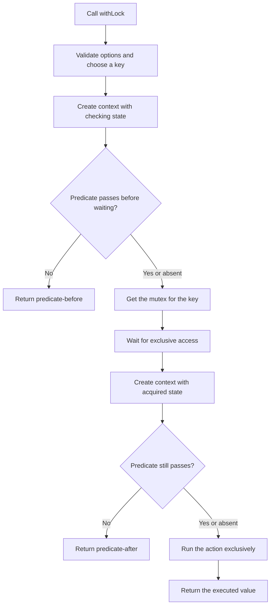
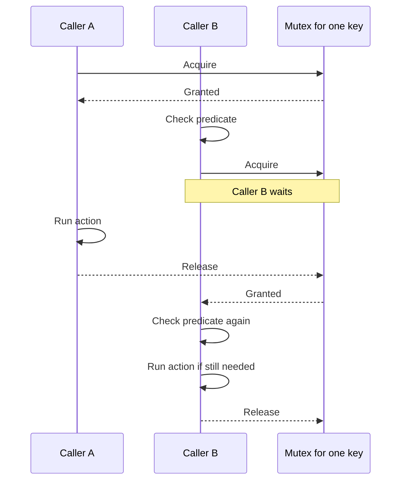

# loqkit

Small typed locking primitives for JavaScript runtimes.

```ts
import { withLock } from "loqkit";

await withLock(
  { resource: "cache" },
  async ({ resource, lock }) => {
    console.log(`locked ${resource} with ${lock.type}`);
  },
  async ({ resource }) => resource === "cache",
  { key: "cache-refresh" },
);
```

The optional predicate runs once before waiting and again after acquisition. The action runs only when both checks pass.

## How it works

`withLock` is an in-process, key-scoped lock. Calls with the same key run one at a time; calls with different keys can run concurrently. If no key is supplied, loqkit derives one by serializing the context with `JSON.stringify`.

loqkit uses [`async-mutex`](https://github.com/DirtyHairy/async-mutex) for the mutex queue and exclusive execution. loqkit adds the keyed registry, validated options, typed lock context, and the predicate checks around that proven primitive.



The second predicate check matters when another caller changes the underlying state while this caller is waiting:



This lock is local to one JavaScript process. It does not coordinate work across processes, servers, or containers; those cases need a shared lock service or database-backed lock.
